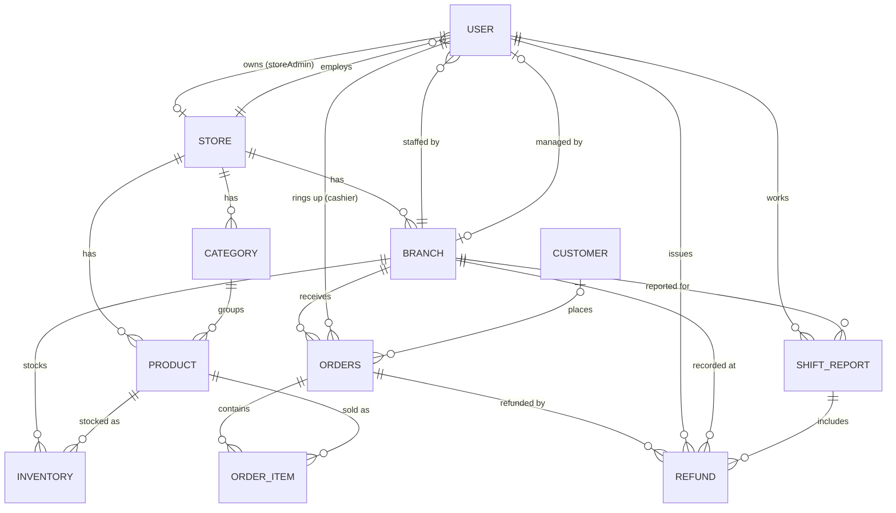
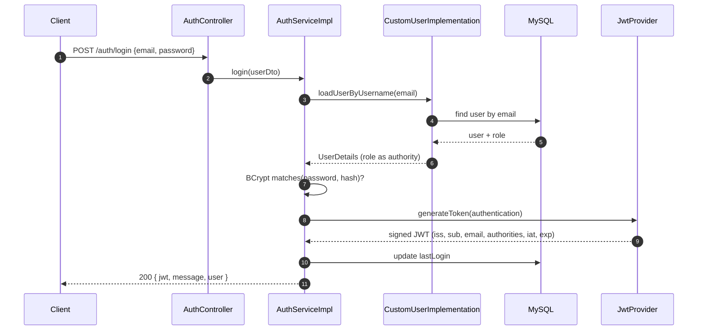
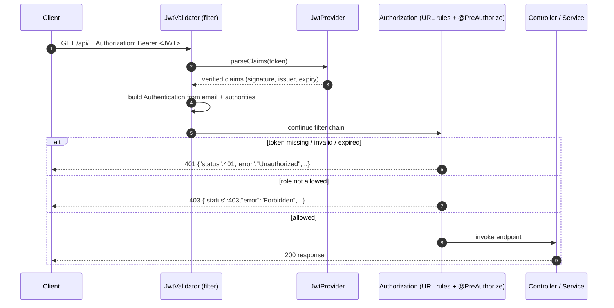

<div align="center">
# Enterprise Multi-Tenant POS System
 
**A secure, role-based Point of Sale backend for multi-store, multi-branch retail — built with Spring Boot, Spring Security and JWT.**
 


 
</div>
---
 
> **Project status:** Backend API complete and under active hardening.
> Authentication, JWT hardening and role-based authorization are implemented (security Phases 1 and 2).
> **Tenant-level data isolation is *not* implemented yet** — see [Current Scope and Known Limitations](#current-scope-and-known-limitations) and the [Roadmap](#future-improvements).
 
---
 
## Table of Contents
 
- 📌 [Overview](#overview)
- ✨ [Features](#features)
- 🏗️ [Project Architecture](#project-architecture)
- 🧰 [Technology Stack](#technology-stack)
- 📁 [Project Structure](#project-structure)
- 🗄️ [Database Design](#database-design)
- 🔑 [Authentication Flow](#authentication-flow)
- 🛡️ [Authorization](#authorization)
- 🌐 [REST API Modules](#rest-api-modules)
- 🔒 [Security Features](#security-features)
- 🧪 [API Testing](#api-testing)
- ⚙️ [Installation Guide](#installation-guide)
- 🔧 [Environment Variables](#environment-variables)
- ▶️ [Running the Project](#running-the-project)
- 📮 [Running the Postman Collection](#running-the-postman-collection)
- 🖼️ [Screenshots](#screenshots)
- ⚠️ [Current Scope and Known Limitations](#current-scope-and-known-limitations)
- 🚀 [Future Improvements](#future-improvements)
- 🤝 [Contributing](#contributing)
- 📄 [License](#license)
- 👤 [Author](#author)
---
 
## Overview
 
**Enterprise Multi-Tenant POS System** is a REST backend that models the day-to-day operations of a retail business running several stores and branches: onboarding stores, managing branches and staff, maintaining a product catalog and branch-level inventory, ringing up sales, handling refunds, reporting on cashier shifts and exposing analytics dashboards for branch managers, store owners and the platform administrator.
 
It is a **layered monolith** (Controller → Service → Repository) — not a microservices system — and secures every API behind **stateless JWT authentication** and **role-based, method-level authorization**.
 
| | |
|---|---|
| **REST endpoints** | 82 across 15 controllers (2 public, 80 protected) |
| **Roles** | 5 (platform admin, store admin, store manager, branch manager, cashier) |
| **Persistence** | 11 JPA entities on MySQL |
| **Auth** | Stateless JWT (HMAC-signed), BCrypt password hashing |
| **Authorization** | URL rules + `@PreAuthorize` on every protected endpoint + default-deny |
 
---
 
## Features
 
### 🔐 Authentication
- Public **signup** that always creates a `ROLE_STORE_ADMIN` account (the role in the request body is ignored)
- **Login** with email and password; returns a signed JWT and the user profile
- JWT carries the issuer, subject, email, authorities, issued-at and expiry claims
- Token lifetime and signing secret are configuration-driven
- **Current-user profile** endpoint (`/api/users/profile`)
### 🛡️ Authorization
- Five-role **RBAC** model enforced with Spring Method Security
- Central `AccessRules` class holding every role expression in one place
- URL-level rules plus method-level `@PreAuthorize` on all 80 protected endpoints
- **Default deny** for any URL that is not explicitly allowed
- Consistent JSON `401 Unauthorized` and `403 Forbidden` responses
### 🏬 Store Management
- Store admins create and update their store (brand, description, type, address, phone, email)
- New stores start in `PENDING` status; the platform admin moderates them to `ACTIVE`, `PENDING` or `BLOCKED`
- Lookup of a store by id, by owning admin, or from an employee's account
- Platform admin can list all registered stores
### 🏢 Branch Management
- Create, read, update and delete branches under a store
- Branch details: address, phone, email, working days, opening and closing time
- Assign a branch manager to a branch
### 👥 Employee Management
- Store admins create store-level staff (store managers, branch managers, cashiers)
- Store admins and store managers create branch-level staff (cashiers, branch managers)
- Role guard: the employee API **cannot** create `ROLE_ADMIN` or `ROLE_STORE_ADMIN` users
- List employees of a store or a branch, optionally filtered by role
- Update and delete employees (store admin only)
### 🗂️ Category and 📦 Product Management
- Store-scoped categories (create, list, rename, delete)
- Products with name, unique SKU, description, MRP, selling price, brand, image and category
- Product search by keyword (name, brand or SKU)
- Partial-style product update endpoint (`PATCH`)
### 🏷️ Inventory Management
- Branch-level stock records per product
- Create, update and delete stock entries
- Query stock for a whole branch or for one product in one branch
### 🙋 Customer Management
- Create, update, delete and list customers
- Keyword search by name or email
### 🧾 Order Management (POS Billing)
- Cashiers and branch managers create orders from the point of sale
- The order is attributed to the logged-in user and their branch
- **Prices and totals are computed on the server** from the product's selling price
- Optional customer link and payment type (`CASH`, `UPI`, `CARD`)
- Query orders by id, branch (filter by customer, cashier or payment type), cashier, customer, today's orders and the five most recent orders
### ↩️ Refund Management
- Create a refund against an order (reason and amount)
- Query refunds by id, cashier, branch, shift or cashier + date range, or list all (store level)
### ⏱️ Shift Reports
- Cashiers start a shift (one shift per cashier per day)
- Live shift progress: orders, sales, payment-method summary, recent orders, top-selling products
- Reports by id, branch, cashier, or cashier and date
### 📊 Analytics
- **Branch analytics:** daily sales chart, top products by quantity, top cashiers by revenue, category-wise sales, today's overview with growth indicators, payment-method breakdown
- **Store analytics:** overview, monthly and daily sales, sales by category, by payment method and by branch, payment insights, branch performance, alerts (low stock, branches without sales today, refund spikes, inactive cashiers)
### 🧭 Platform Admin Dashboard
- Store counts by status, store registrations over the last 7 days, status distribution
---
 
## Project Architecture
 
The application is a **layered monolith**: one Spring Boot process, one MySQL database, clear separation between layers.
 
```text
┌──────────────────────────────────────────────────────────────────────┐
│                CLIENT  (Postman / Web or Mobile Frontend)            │
└─────────────────────────────────┬────────────────────────────────────┘
                                  │  HTTP + JSON   (Authorization: Bearer <JWT>)
                                  ▼
┌──────────────────────────────────────────────────────────────────────┐
│                       SPRING BOOT REST API  (port 5000)              │
│                                                                      │
│  ┌────────────────────────────────────────────────────────────────┐  │
│  │  SECURITY FILTER CHAIN                                         │  │
│  │  CORS ─► JwtValidator (token → Authentication) ─► URL rules    │  │
│  │          401/403 JSON handlers · default deny                  │  │
│  └───────────────────────────────┬────────────────────────────────┘  │
│                                  ▼                                   │
│  ┌────────────────────────────────────────────────────────────────┐  │
│  │  CONTROLLER LAYER   @RestController · @PreAuthorize(AccessRules)│  │
│  └───────────────────────────────┬────────────────────────────────┘  │
│                                  ▼                                   │
│  ┌────────────────────────────────────────────────────────────────┐  │
│  │  SERVICE LAYER      business rules · orchestration             │  │
│  │  (interfaces + impl)         ◄──── Mapper / DTO (payload)      │  │
│  └───────────────────────────────┬────────────────────────────────┘  │
│                                  ▼                                   │
│  ┌────────────────────────────────────────────────────────────────┐  │
│  │  REPOSITORY LAYER   Spring Data JPA · JPQL / native queries    │  │
│  └───────────────────────────────┬────────────────────────────────┘  │
└──────────────────────────────────┼───────────────────────────────────┘
                                   ▼
                       ┌────────────────────────┐
                       │     MySQL Database     │
                       └────────────────────────┘
```
 
### Responsibilities of each layer
 
| Layer | Package | Responsibility |
|---|---|---|
| **Security** | `configuration` | Filter chain, JWT creation and validation, CORS, password encoder, role expressions |
| **Controller** | `controller` | Maps HTTP to Java, declares which roles may call each endpoint, returns `ResponseEntity` |
| **Service** | `service`, `service.impl` | Business rules (role guards, ownership checks, price calculation, shift logic, analytics aggregation) |
| **Mapper / DTO** | `mapper`, `payload` | Converts entities to API contracts so entities are not exposed directly |
| **Repository** | `repository` | Persistence, derived queries, JPQL and native analytics queries |
| **Entity** | `modal` | JPA entity model and relationships |
| **Domain** | `domain` | Enumerations (`UserRole`, `StoreStatus`, `PaymentType`, `OrderStatus`) |
 
---
 
## Technology Stack
 
| Category | Technology | Version / Notes |
|---|---|---|
| Language | Java | 17 (`java.version` in `pom.xml`) |
| Framework | Spring Boot | 4.0.2 |
| Web | Spring Web MVC (`spring-boot-starter-webmvc`) | managed by Boot |
| Security | Spring Security | managed by Boot |
| JWT | JJWT (`jjwt`, `jjwt-impl`, `jjwt-jackson`) | 0.12.6 |
| Persistence | Spring Data JPA + Hibernate | managed by Boot |
| Database | MySQL (`mysql-connector-j`) | MySQL 8.x recommended |
| Boilerplate | Lombok | 1.18.32 |
| Build | Maven (Maven Wrapper included) | `mvnw` / `mvnw.cmd` |
| Dev tooling | Spring Boot DevTools | runtime, optional |
| API testing | Postman | collection included |
 
<details>
<summary>Dependencies declared in <code>pom.xml</code> but not used by the current code</summary>
`spring-boot-starter-mail`, `stripe-java` (28.3.1) and `razorpay-java` (1.4.8) are declared as dependencies, but **no email sending or payment-gateway integration is implemented**. Orders record a payment *type* (`CASH`, `UPI`, `CARD`) only. `spring-boot-starter-validation` is also present; request-body validation (`@Valid`) is not applied yet.
 
</details>
---
 
## Project Structure
 
```text
.
├── pom.xml
├── mvnw / mvnw.cmd                       # Maven wrapper
├── vijay-pos.postman_collection.json     # Postman collection (49 requests)
└── src
    ├── main/java/com/tap
    │   ├── PosSystemApplication.java     # Spring Boot entry point
    │   │
    │   ├── configuration/                # Security & JWT
    │   │   ├── SecurityConfig.java       #   filter chain, CORS, 401/403 handlers, BCrypt bean
    │   │   ├── JwtProvider.java          #   token generation + parsing/verification
    │   │   ├── JwtValidator.java         #   per-request JWT filter
    │   │   └── AccessRules.java          #   central role expressions for @PreAuthorize
    │   │
    │   ├── controller/                   # 15 REST controllers
    │   ├── service/                      # 15 service interfaces
    │   │   └── impl/                     #   16 implementations (incl. UserDetailsService)
    │   ├── repository/                   # 11 Spring Data JPA repositories
    │   ├── modal/                        # JPA entities (package name is "modal")
    │   ├── domain/                       # Enums: UserRole, StoreStatus, PaymentType, OrderStatus
    │   ├── mapper/                       # Entity ⇄ DTO mappers
    │   ├── exceptions/                   # UserException
    │   └── payload/
    │       ├── dto/                      # Request/response DTOs
    │       ├── response/                 # AuthResponse, ApiResponse
    │       ├── adminAnalytics/           # Platform dashboard DTOs
    │       ├── storeAnalytics/           # Store analytics DTOs
    │       └── branchAnalytics/          # Branch analytics DTOs
    └── test/java/com/tap
        └── PosSystemApplicationTests.java   # context-load test only
```
 
| Package | Purpose |
|---|---|
| `configuration` | Everything security-related lives here: filter chain, JWT provider/filter, CORS, role constants |
| `controller` | One controller per module; each endpoint is annotated with its allowed roles |
| `service` / `service.impl` | Interface + implementation per module; contains the business rules |
| `repository` | `JpaRepository` interfaces with derived queries and custom `@Query` analytics queries |
| `modal` | Entities: `User`, `Store`, `Branch`, `Category`, `Product`, `Inventory`, `Customer`, `Order`, `OrderItem`, `Refund`, `ShiftReport` (+ embeddable `StoreContact`) |
| `domain` | Enumerations used by entities and APIs |
| `mapper` | Static mappers converting entities to DTOs (one `OrderItemMapper` also sits in `payload/dto`) |
| `exceptions` | Custom `UserException` (there is no global exception handler yet) |
| `payload` | DTOs grouped by purpose, including analytics projections |
 
---
 
## Database Design
 
Schema generation is handled by **Hibernate** (no SQL migration scripts are included). Primary keys use `GenerationType.AUTO`.
 

 
### Entities
 
| Entity (table) | Key fields | Relationships |
|---|---|---|
| **User** (`user`) | `fullName`, unique `email`, `phone`, `role`, hashed `password`, `lastLogin`, timestamps | Many-to-one `Store`, many-to-one `Branch` |
| **Store** | `brand`, `description`, `storeType`, `status`, embedded contact (address, phone, email), timestamps | One-to-one `storeAdmin` (`User`) |
| **Branch** | `name`, address, phone, email, `workingDays` (separate collection table), `openTime`, `closeTime` | Many-to-one `Store`; one-to-one `manager` (`User`) |
| **Category** | `name` | Many-to-one `Store` |
| **Product** | `name`, unique `sku`, `description`, `mrp`, `sellingPrice`, `brand`, `image`, timestamps | Many-to-one `Category`, many-to-one `Store` |
| **Inventory** | `quantity`, `lastUpdated` | Many-to-one `Branch`, many-to-one `Product` |
| **Customer** | `fullName`, `email`, `phone`, timestamps | Standalone (not linked to a store yet) |
| **Order** (`orders`) | `totalAmount`, `paymentType`, `createdAt` | Many-to-one `Branch`, `User` (cashier), `Customer`; one-to-many `OrderItem` (cascade) |
| **OrderItem** | `quantity`, `price` | Many-to-one `Product`, many-to-one `Order` |
| **Refund** | `reason`, `amount`, `createdAt`, `paymentType` | Many-to-one `Order`, `User` (cashier), `Branch`, `ShiftReport` |
| **ShiftReport** | `shiftStart`, `shiftEnd`, `totalSales`, `totalRefunds`, `netSale`, `totalOrders` | Many-to-one `User` (cashier), `Branch`; collections of top products, recent orders and refunds |
 
### Enumerations
 
| Enum | Values |
|---|---|
| `UserRole` | `ROLE_ADMIN`, `ROLE_STORE_ADMIN`, `ROLE_BRANCH_CASHIER`, `ROLE_BRANCH_MANAGER`, `ROLE_STORE_MANAGER` |
| `StoreStatus` | `ACTIVE`, `PENDING`, `BLOCKED` |
| `PaymentType` | `CASH`, `UPI`, `CARD` |
| `OrderStatus` | `PENDING`, `COMPLETED` (defined; not persisted on orders) |
 
> **Note:** enums are stored with Hibernate's default (ordinal) mapping. `ROLE_ADMIN` is ordinal `0`.
 
---
 
## Authentication Flow
 
Authentication is **stateless**: no HTTP session is created. The server verifies each request from the JWT alone.
 
### Login and token issuance
 

 
### Calling a protected API
 

 
### In short
 
```text
Login ─► load user (UserDetailsService) ─► BCrypt password check ─► JWT generation
      ─► client stores token ─► Authorization: Bearer <token> on every call
      ─► JwtValidator verifies signature + issuer + expiry ─► roles from "authorities" claim
      ─► URL rules ─► @PreAuthorize ─► controller
```
 
**Token details**
 
| Claim | Meaning |
|---|---|
| `iss` | Issuer (`jwt.issuer`); validated on every request |
| `sub` / `email` | The user's email address |
| `authorities` | Comma-separated roles, e.g. `ROLE_STORE_ADMIN` |
| `iat` / `exp` | Issued-at and expiry (`jwt.expiration-ms` after issue) |
 
The signing algorithm (HMAC-SHA) is selected by JJWT from the length of the configured secret. Roles are read from the token, so after a role change in the database the user must log in again to receive a token with the new role.
 
---
 
## Authorization
 
Authorization is enforced in **three layers**:
 
1. **URL rules** in `SecurityConfig` — `/auth/**` and `/error` public, `/api/super-admin/**` requires `ADMIN`, `/api/**` requires authentication, **everything else is denied**.
2. **Method security** — `@EnableMethodSecurity` with a `@PreAuthorize(AccessRules.…)` annotation on every protected controller method.
3. **Service-level guards** — e.g. role allow-lists when creating employees; store/branch ownership checks in the branch and category services.
### Roles
 
| Role | Description | Typical scope |
|---|---|---|
| `ROLE_ADMIN` | Platform administrator | Moderates stores, lists all stores, platform dashboard. Cannot be created through any API |
| `ROLE_STORE_ADMIN` | Store owner (created via public signup) | Creates/updates the store, branches, staff, catalog, inventory; store analytics |
| `ROLE_STORE_MANAGER` | Store-level manager | Branches, catalog, inventory, branch staff, store analytics, refunds overview |
| `ROLE_BRANCH_MANAGER` | Branch manager | Inventory, branch staff lists, branch analytics, branch orders/refunds/shifts; can operate the POS |
| `ROLE_BRANCH_CASHIER` | Cashier | Runs shifts, creates orders and refunds, reads catalog/stock, manages customers |
 
> There is **no role hierarchy**: `ROLE_ADMIN` is intentionally limited to platform endpoints and cannot call store-operation endpoints.
 
### Rule constants (`AccessRules`)
 
| Constant | Roles allowed |
|---|---|
| `PLATFORM_ADMIN` | `ADMIN` |
| `STORE_ADMIN` | `STORE_ADMIN` |
| `STORE_LEVEL` | `STORE_ADMIN`, `STORE_MANAGER` |
| `BRANCH_LEVEL` | `STORE_ADMIN`, `STORE_MANAGER`, `BRANCH_MANAGER` |
| `POS_OPERATOR` | `BRANCH_CASHIER`, `BRANCH_MANAGER` |
| `CASHIER` | `BRANCH_CASHIER` |
| `ALL_STAFF` | `STORE_ADMIN`, `STORE_MANAGER`, `BRANCH_MANAGER`, `BRANCH_CASHIER` |
| `ANY_USER` | any authenticated user |
 
### Permission matrix
 
Legend: **ADM** platform admin · **SA** store admin · **SM** store manager · **BM** branch manager · **CS** cashier
 
<details>
<summary><b>Click to expand the full endpoint-to-role matrix</b></summary>
| Module | Operation | Allowed roles |
|---|---|---|
| Auth | signup, login | Public |
| Users | own profile | any authenticated user |
| Users | get user by id | SA, SM, BM |
| Stores | create store, get own store, update, delete | SA |
| Stores | list all stores, moderate (set status) | ADM |
| Stores | get store of the logged-in employee | SA, SM, BM, CS |
| Stores | get store by id | any authenticated user |
| Branches | create, read, list, update, delete | SA, SM |
| Employees | create store-level employee, update, delete | SA |
| Employees | create branch-level employee | SA, SM |
| Employees | list store employees | SA, SM |
| Employees | list branch employees | SA, SM, BM |
| Categories | create, update, delete | SA, SM |
| Categories | list by store | SA, SM, BM, CS |
| Products | create, update, delete | SA, SM |
| Products | list by store, keyword search | SA, SM, BM, CS |
| Inventory | create, update, delete | SA, SM, BM |
| Inventory | read by branch / by branch + product | SA, SM, BM, CS |
| Customers | create, update, search | SA, SM, BM, CS |
| Customers | list all | SA, SM, BM |
| Customers | delete | SA, SM |
| Orders | create | BM, CS |
| Orders | list by branch | SA, SM, BM |
| Orders | by id, cashier, customer, today, recent | SA, SM, BM, CS |
| Refunds | create | BM, CS |
| Refunds | list all | SA, SM |
| Refunds | list by branch | SA, SM, BM |
| Refunds | by id, cashier, shift, date range | SA, SM, BM, CS |
| Shift reports | start, end, current progress | CS |
| Shift reports | list by branch | SA, SM, BM |
| Shift reports | by id, cashier, cashier + date | SA, SM, BM, CS |
| Branch analytics | all endpoints | SA, SM, BM |
| Store analytics | all endpoints | SA, SM |
| Admin dashboard | all endpoints | ADM |
 
</details>
### Account-creation rules
 
- **Signup** (`POST /auth/signup`) always produces `ROLE_STORE_ADMIN`. A role sent in the body is ignored, so nobody can self-register as a manager, cashier or platform admin.
- **Store-level employee creation** rejects `ROLE_ADMIN`, `ROLE_STORE_ADMIN` and a missing role.
- **Branch-level employee creation** accepts only `ROLE_BRANCH_CASHIER` and `ROLE_BRANCH_MANAGER`.
- `ROLE_ADMIN` cannot be created through the API (see [Creating the first platform admin](#4-create-the-first-platform-admin)).
---
 
## REST API Modules
 
Base URL (local): `http://localhost:5000`
 
| Controller | Base path | Responsibility |
|---|---|---|
| `AuthController` | `/auth` | Public signup (store admin) and login; returns the JWT |
| `UserController` | `/api/users` | Current-user profile and user lookup |
| `StoreController` | `/api/stores` | Store onboarding, update, delete, lookup and platform moderation |
| `BranchController` | `/api/branches` | Branch CRUD under a store |
| `EmployeeController` | `/api/employees` | Create, update, delete and list store/branch staff |
| `CategoryController` | `/api/categories` | Store category management |
| `ProductController` | `/api/products` | Product catalog management and search |
| `InventoryController` | `/api/inventories` | Branch-level stock records |
| `CustomerController` | `/api/customers` | Customer records and search |
| `OrderController` | `/api/orders` | POS order creation and order queries |
| `RefundController` | `/api/refunds` | Refund creation and refund queries |
| `ShiftReportController` | `/api/shift-reports` | Cashier shifts and shift reports |
| `BranchAnalyticsController` | `/api/branch-analytics` | Branch-level sales analytics |
| `StoreAnalyticsController` | `/api/store/analytics/{storeAdminId}` | Store-level analytics and alerts |
| `AdminDashboardController` | `/api/super-admin/dashboard` | Platform-wide store statistics |
 
**Conventions:** JSON request/response bodies; creates and updates return `200 OK`; `ApiResponse` (`{ "message": ... }`) for deletes; query parameters for filters (e.g. `?userRole=`, `?paymentType=`, `?q=`).
 
---
 
## Security Features
 
| | Feature | Details |
|---|---|---|
| ✔ | **JWT authentication** | HMAC-signed tokens with issuer, subject, email, authorities, issued-at and expiry claims |
| ✔ | **Spring Security** | Stateless filter chain; no HTTP session; CSRF disabled (token-based API) |
| ✔ | **Role-Based Access Control** | Five roles; permissions defined once in `AccessRules` |
| ✔ | **Method-level authorization** | `@EnableMethodSecurity` + `@PreAuthorize` on all 80 protected endpoints |
| ✔ | **Default deny** | `.anyRequest().denyAll()` — unmapped URLs are never exposed |
| ✔ | **Password hashing** | BCrypt on signup and employee creation; passwords are never returned in responses |
| ✔ | **Secrets in environment variables** | JWT secret is read from configuration (`JWT_SECRET`); no secret is hardcoded in source |
| ✔ | **Secret strength check** | Application refuses to start if `jwt.secret` is missing or shorter than 32 bytes |
| ✔ | **Configurable token lifetime** | `jwt.expiration-ms` |
| ✔ | **Issuer validation** | Tokens with a different issuer are rejected |
| ✔ | **Hardened JWT filter** | Invalid, expired or tampered tokens leave the request unauthenticated (→ 401), never a server error; only the exact `Bearer ` scheme is accepted |
| ✔ | **Authentication entry point** | JSON `401 Unauthorized` for missing/invalid tokens |
| ✔ | **Access-denied handler** | JSON `403 Forbidden` for insufficient role |
| ✔ | **CORS** | Allowed origins from configuration; methods `GET, POST, PUT, PATCH, DELETE, OPTIONS`; headers `Authorization`, `Content-Type` |
| ✔ | **Signup restriction** | Public signup can only create store admins |
| ✔ | **Employee role guard** | Employee API cannot create `ROLE_ADMIN` or `ROLE_STORE_ADMIN` |
| ✔ | **Parameterised queries** | Spring Data derived queries and bound JPQL/native parameters |
| ✔ | **Git hygiene** | `application.properties` and `.env` are git-ignored |
 
Error response bodies produced by the security layer:
 
```json
{ "status": 401, "error": "Unauthorized", "message": "Missing or invalid token" }
{ "status": 403, "error": "Forbidden",    "message": "You do not have permission to access this resource" }
```
 
---
 
## API Testing
 
A **Postman collection** (`vijay-pos.postman_collection.json`) is included, with **49 requests** grouped by module: user/auth, store, category, product, branch, inventory, employee, customer, order, refund and shift report.
 
The API was tested manually through Postman, using one account per role. The scenarios exercised were:
 
| Area | What is verified | Expected result |
|---|---|---|
| **Authentication testing** | Signup, login, profile with a valid token | `200` with JWT / user data |
| **Role escalation on signup** | Signup with `ROLE_ADMIN` / `ROLE_STORE_MANAGER` in the body | Account is created as `ROLE_STORE_ADMIN` |
| **No-token testing** | Protected endpoint without an `Authorization` header | `401` JSON |
| **Invalid-JWT testing** | Garbage token, tampered signature, expired token, wrong issuer, wrong scheme (`bearer`, no prefix, `Basic`) | `401` JSON |
| **Authorization testing** | Each endpoint called with roles outside its allowed set | `403` JSON |
| **Role testing** | Each role calling the endpoints it *should* reach | Not `401`/`403` |
| **Employee role guard** | Creating `ROLE_ADMIN` / `ROLE_STORE_ADMIN` through the employee API | Request rejected, no user created |
| **Default deny** | Unknown URLs, e.g. `/random` | `401` without a token, `403` with one |
| **CORS** | Pre-flight from the configured origin vs. an unknown origin | Allowed vs. `403 Invalid CORS request` |
 
> **Automated tests:** the repository currently contains only the default Spring Boot context-load test (`PosSystemApplicationTests`). Unit and integration tests are listed under [Future Improvements](#future-improvements).
 
---
 
## Installation Guide
 
### Prerequisites
 
| Requirement | Version |
|---|---|
| JDK | 17 or newer |
| MySQL | 8.x |
| Maven | 3.6+ *(optional — the Maven Wrapper is included)* |
| Git | any recent version |
| Postman | optional, for API testing |
 
### 1. Clone the repository
 
```bash
git clone https://github.com/dvijaykumarr/multi-tenant-pos.git
cd multi-tenant-pos
```
 
### 2. Create the database
 
```sql
CREATE DATABASE pos_db CHARACTER SET utf8mb4 COLLATE utf8mb4_unicode_ci;
```
 
Create a dedicated MySQL user if you prefer not to use `root`:
 
```sql
CREATE USER 'pos_user'@'localhost' IDENTIFIED BY 'change_me';
GRANT ALL PRIVILEGES ON pos_db.* TO 'pos_user'@'localhost';
FLUSH PRIVILEGES;
```
 
### 3. Create `application.properties`
 
`application.properties` is **git-ignored on purpose** (it holds secrets), so it is not in the repository. Create `src/main/resources/application.properties` with the following content:
 
```properties
# --- Server ---
server.port=5000
 
# --- Database ---
spring.datasource.url=${DB_URL:jdbc:mysql://localhost:3306/pos_db}
spring.datasource.username=${DB_USERNAME}
spring.datasource.password=${DB_PASSWORD}
 
# --- JPA / Hibernate (schema is generated from the entities) ---
spring.jpa.hibernate.ddl-auto=update
 
# --- JWT ---
jwt.secret=${JWT_SECRET}
jwt.expiration-ms=${JWT_EXPIRATION_MS:86400000}
jwt.issuer=pos-system
 
# --- CORS (comma-separated list of allowed frontend origins) ---
app.cors.allowed-origins=${CORS_ALLOWED_ORIGINS:http://localhost:5173}
```
 
> `jwt.secret`, `jwt.expiration-ms`, `jwt.issuer` and `app.cors.allowed-origins` are **required**: the application will not start without them.
 
### 4. Set the environment variables
 
Generate a strong secret (at least 32 bytes; 48 random bytes recommended):
 
```bash
openssl rand -base64 48
```
 
<details>
<summary><b>Windows (PowerShell)</b></summary>
```powershell
$env:JWT_SECRET="<paste-generated-secret>"
$env:DB_USERNAME="pos_user"
$env:DB_PASSWORD="change_me"
# optional
$env:JWT_EXPIRATION_MS="86400000"
$env:CORS_ALLOWED_ORIGINS="http://localhost:5173"
```
 
</details>
<details>
<summary><b>Linux / macOS (bash or zsh)</b></summary>
```bash
export JWT_SECRET="<paste-generated-secret>"
export DB_USERNAME="pos_user"
export DB_PASSWORD="change_me"
# optional
export JWT_EXPIRATION_MS=86400000
export CORS_ALLOWED_ORIGINS="http://localhost:5173"
```
 
</details>
<details>
<summary><b>IntelliJ IDEA</b></summary>
*Run → Edit Configurations → your Spring Boot configuration → Environment variables*, then add `JWT_SECRET=…;DB_USERNAME=…;DB_PASSWORD=…`.
 
</details>
Never commit the secret. Use a different secret for every environment.
 
---
 
## Environment Variables
 
| Variable | Required | Default | Description |
|---|:---:|---|---|
| `JWT_SECRET` | ✅ | — | HMAC signing secret for JWTs. Must be **≥ 32 bytes**; startup fails otherwise |
| `JWT_EXPIRATION_MS` | ➖ | `86400000` (24 h) | Token lifetime in milliseconds |
| `CORS_ALLOWED_ORIGINS` | ➖ | `http://localhost:5173` | Comma-separated list of origins allowed by CORS |
| `DB_URL` | ➖ | `jdbc:mysql://localhost:3306/pos_db` | JDBC URL of the MySQL database |
| `DB_USERNAME` | ✅ | — | Database user |
| `DB_PASSWORD` | ✅ | — | Database password |
 
Additional properties set directly in `application.properties`:
 
| Property | Value | Description |
|---|---|---|
| `server.port` | `5000` | HTTP port (the Postman collection uses `5000`) |
| `jwt.issuer` | `pos-system` | Issuer written into, and required from, every token |
| `spring.jpa.hibernate.ddl-auto` | `update` | Lets Hibernate create/update tables from the entities |
 
---
 
## Running the Project
 
### 1. Build
 
```bash
./mvnw clean package -DskipTests        # Linux / macOS
mvnw.cmd clean package -DskipTests      # Windows
```
 
### 2. Start the application
 
```bash
./mvnw spring-boot:run                  # Linux / macOS
mvnw.cmd spring-boot:run                # Windows
```
 
or run the packaged jar:
 
```bash
java -jar target/pos-system-0.0.1-SNAPSHOT.jar
```
 
The API is now available at **`http://localhost:5000`**. Hibernate creates the tables on first start.
 
### 3. Verify it is running
 
```bash
# No token → the security layer answers with JSON 401
curl -i http://localhost:5000/api/users/profile
```
 
```bash
# Register a store admin
curl -X POST http://localhost:5000/auth/signup \
  -H "Content-Type: application/json" \
  -d '{"fullName":"Store Owner","email":"owner@example.com","password":"Password@123","phone":"9876500001"}'
```
 
```bash
# Log in and use the returned token
curl -X POST http://localhost:5000/auth/login \
  -H "Content-Type: application/json" \
  -d '{"email":"owner@example.com","password":"Password@123"}'
 
curl http://localhost:5000/api/users/profile -H "Authorization: Bearer <jwt>"
```
 
### 4. Create the first platform admin
 
`ROLE_ADMIN` cannot be created through the API. Register a normal account with signup, then promote it **once** in the database (`0` is the ordinal of `ROLE_ADMIN`):
 
```sql
USE pos_db;
UPDATE `user` SET role = 0 WHERE email = 'admin@example.com';
```
 
Log in again afterwards so the new token carries `ROLE_ADMIN`.
 
### 5. Suggested first-use workflow
 
```text
1. Sign up            POST /auth/signup                 → store admin account
2. Create store       POST /api/stores                  → status PENDING
3. Approve store      PUT  /api/stores/{id}/moderate?status=ACTIVE     (platform admin)
4. Create branch      POST /api/branches
5. Create staff       POST /api/employees/store/{storeId}   or   /api/employees/branch/{branchId}
6. Add catalog        POST /api/categories, POST /api/products
7. Add stock          POST /api/inventories
8. Start shift        POST /api/shift-reports/start     (as cashier)
9. Sell               POST /api/orders                  (as cashier)
```
 
### 6. Run the tests
 
```bash
./mvnw test
```
 
This runs the context-load test, which needs the database and the environment variables above to be available.
 
---
 
## Running the Postman Collection
 
1. **Import** `vijay-pos.postman_collection.json` (*Postman → Import → select the file*).
2. **Create an environment** (e.g. `POS Local`) and select it. The requests use fixed URLs on `http://localhost:5000`, so the server must run on port `5000`.
3. **Log in first.** Send **user api → login** with a valid account. Its test script stores the returned token in the environment variable `store_admin_jwt`.
4. **Use the token.** The collection's requests carry their own Bearer values from earlier runs. Those tokens are old and **will be rejected (401)** after the JWT hardening. Either:
   - open the collection → *Authorization* tab → type *Bearer Token* → value `{{store_admin_jwt}}`, then set each request's *Authorization* to **Inherit auth from parent**; or
   - paste a fresh token into each request.
5. **Adjust IDs.** Path parameters such as `/api/stores/1`, `/api/categories/store/52` or `/api/orders/cashier/352` are examples from a local database; replace them with IDs from your data.
6. **Test other roles.** Create a store manager, branch manager and cashier through the employee endpoints, log in as each, and call the same endpoints to confirm the allowed (`2xx`/business error) and denied (`403`) behaviour. Remove the `Authorization` header to confirm `401`.
> Do not commit real tokens or passwords to the collection.
 
---
 
## Screenshots
 
> Add screenshots to a `docs/images/` folder and update the paths below.
 
### Login

 
### Store Admin Dashboard

 
### Platform Admin Dashboard

 
### POS Billing

 
### Analytics

 
### Postman Collection

 
---
 
## Current Scope and Known Limitations
 
This section describes the project's status honestly, so readers know exactly what the code does today.
 
| Area | Current behaviour |
|---|---|
| **Tenant isolation** | **Not implemented yet.** Role checks decide *what kind of action* a user may perform, but most queries do not yet restrict data to the caller's own store. Customers are not linked to a store. Do not use with real multi-tenant production data. |
| **Error responses** | There is no global exception handler. Business errors (not found, duplicate email, wrong password, ownership failures) currently surface as HTTP `500`. Only the `401`/`403` security responses are structured JSON. |
| **Request validation** | Bean validation (`@Valid`) is not applied to request bodies. |
| **Shift end** | `PATCH /api/shift-reports/end` is implemented but does not yet record the shift end time correctly. |
| **Inventory on sale** | Creating an order does not deduct stock from inventory. |
| **Analytics** | `GET …/sales-trends` is a placeholder and returns an empty body. |
| **Money type** | Monetary values use `Double`. |
| **Tests** | Only the default context-load test exists. |
| **Packaging** | No Docker, CI/CD or API documentation (Swagger/OpenAPI) is included. |
 
---
 
## Future Improvements
 
Planned work, in rough priority order:
 
- [ ] **Tenant isolation** — scope every query to the caller's store; link customers to stores; return `404` for other tenants' records
- [ ] **Global exception handling** — proper `400/404/409` responses with a consistent error body
- [ ] **Request validation** — `@Valid` with Bean Validation on all request DTOs
- [ ] **Separate request/response DTOs** — stop binding entities directly in requests (mass-assignment protection)
- [ ] **Complete the role-assignment rules** — caller-based matrix for who may create or change which roles, and hashing on password updates
- [ ] **Order flow** — stock deduction, refund validation (amount vs. order total), shift linkage
- [ ] **Fix the shift-end endpoint** and finish the sales-trends analytics
- [ ] **Automated tests** — unit tests, MockMvc security tests (role × endpoint) and Testcontainers integration tests
- [ ] **Pagination** for list endpoints
- [ ] **`BigDecimal`** for monetary values and `@Enumerated(EnumType.STRING)` for enums
- [ ] **Database migrations** with Flyway or Liquibase
- [ ] **Swagger / OpenAPI** documentation
- [ ] **Docker and Docker Compose** (application + MySQL)
- [ ] **GitHub Actions** CI (build + test)
- [ ] **Caching** for read-heavy catalog and analytics queries
- [ ] **Monitoring** — Actuator health checks and metrics
- [ ] **Rate limiting** and login throttling on `/auth/**`
- [ ] **Refresh tokens / token revocation**
---
 
## Contributing
 
Contributions, issues and feature requests are welcome.
 
1. Fork the repository
2. Create a feature branch: `git checkout -b feature/your-feature`
3. Commit your changes: `git commit -m "Add your feature"`
4. Push the branch: `git push origin feature/your-feature`
5. Open a Pull Request
Please keep changes focused, follow the existing package structure, and never commit secrets or `application.properties`.
 
---
 
## License
 
_No license file is included yet._ Add a `LICENSE` file (for example MIT) and update this section, e.g.:
 
```text
This project is licensed under the <LICENSE NAME> License — see the LICENSE file for details.
```
 
---
 
## Author
 
**Daarivemula Vijay Kumar**
 
- 📧 Email: [dvk200507@gmail.com](mailto:dvk200507@gmail.com)
- 💼 LinkedIn: [linkedin.com/in/dvijaykumarr](https://linkedin.com/in/dvijaykumarr)
- 🐙 GitHub: [github.com/dvijaykumarr](https://github.com/dvijaykumarr)
---
 
<div align="center">
⭐ If you find this project useful, consider giving it a star.
 
*Built with Spring Boot, Spring Security and JWT.*
 
</div>
 


Claude finished the response
